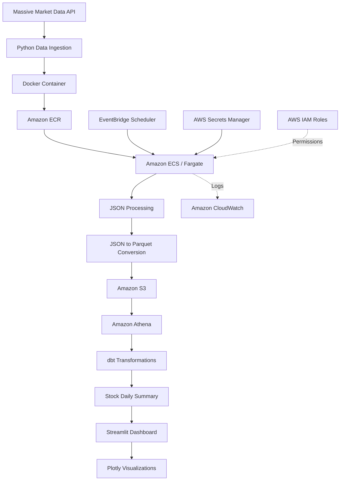

# AWS Financial Market Analytics Pipeline & Interactive Dashboard

## 1. Project Overview

An end-to-end cloud data engineering and analytics solution designed to automate the collection, processing, storage, transformation, and visualization of financial market data.

The project integrates the Massive market data API with a Python-based ingestion application deployed as a Docker container on Amazon ECS using AWS Fargate. The pipeline retrieves stock market data, processes raw JSON responses into optimized Parquet files, and stores both raw and processed datasets in Amazon S3.

Amazon Athena provides serverless SQL querying, while dbt manages data transformations and analytical modeling. AWS EventBridge Scheduler automates weekly pipeline execution, and AWS Secrets Manager and Amazon CloudWatch support secure credential management and operational monitoring.

An interactive Streamlit dashboard, powered by Plotly, connects to Athena to display stock performance, trading volume, and market analytics.

**Project objectives:**
- Build an automated, cloud-based financial data pipeline.
- Integrate external market data through a REST API.
- Implement containerized data processing with Docker and AWS Fargate.
- Store raw and processed datasets in Amazon S3.
- Convert JSON data into analytics-ready Parquet format.
- Implement SQL transformations and data modeling using dbt.
- Query cloud data using Amazon Athena.
- Automate pipeline execution with EventBridge Scheduler.
- Develop an interactive analytics dashboard using Streamlit and Plotly.

---

## 2. Solution Architecture



**Architecture flow:**

Massive API → Python → Docker → Amazon ECR → Amazon ECS/Fargate → JSON-to-Parquet Processing → Amazon S3 → Amazon Athena → dbt → Streamlit Dashboard.

EventBridge Scheduler triggers the ECS task. Secrets Manager provides API credentials, IAM controls service permissions, and CloudWatch captures execution logs.

---

## 3. Technology Stack

| Category | Technologies |
|---|---|
| Programming Languages | Python, SQL |
| Data Source | Massive API |
| API Integration | REST API |
| Containerization | Docker |
| Container Registry | Amazon ECR |
| Cloud Compute | Amazon ECS, AWS Fargate |
| Cloud Storage | Amazon S3 |
| Data Formats | JSON, Apache Parquet |
| Query Engine | Amazon Athena |
| Data Transformation | dbt |
| Scheduling | Amazon EventBridge Scheduler |
| Security | AWS IAM, AWS Secrets Manager |
| Monitoring | Amazon CloudWatch |
| Dashboard | Streamlit, Plotly |
| SDK | Boto3 |
| Version Control | Git, GitHub |

---

## 4. Data Ingestion

The pipeline uses Python to retrieve financial market data from the Massive API.

**Stock symbols monitored:**
- AAPL — Apple
- MSFT — Microsoft
- NVDA — NVIDIA
- AMZN — Amazon
- GOOGL — Alphabet
- META — Meta
- TSLA — Tesla

The ingestion process:
- Connects to the external market data API.
- Retrieves previous trading-day aggregate data for each ticker.
- Processes API responses using Python.
- Saves raw API responses in JSON format.
- Prepares data for downstream processing and analytics.

The API key is managed securely through AWS Secrets Manager rather than being embedded in the application code.

---

## 5. Containerization and Cloud Deployment

The Python pipeline is packaged into a Docker image to provide a consistent execution environment.

**Amazon ECR**
- Stores versioned Docker container images.
- Provides the image repository used by ECS.

**Amazon ECS and AWS Fargate**
- Runs the containerized Python pipeline.
- Uses serverless container infrastructure without requiring management of EC2 instances.
- Executes ingestion and processing workloads on demand.

**AWS IAM**
- Provides task execution and task permissions.
- Controls access to AWS services such as S3, Secrets Manager, and CloudWatch.

---

## 6. Data Processing and Storage

The pipeline separates raw data from processed analytical data using Amazon S3.

**Raw data layer**
- Stores original API responses in JSON format.
- Preserves source data for reference and reprocessing.

**Processed data layer**
- Converts JSON market data into Apache Parquet.
- Uses a columnar storage format suitable for analytical queries.
- Stores processed files in a separate S3 prefix.

**S3 organization:**

```text
financial-market-analytics-raw/
│
├── raw/
│   └── JSON market data
│
├── processed/
│   └── Parquet market data
│
├── dbt-data/
│   └── dbt-related data
│
└── athena-results/
    └── Athena query results
```

This architecture provides a separation between source data, processed datasets, and analytical query outputs.

---

## 7. Automated Scheduling and Orchestration

Amazon EventBridge Scheduler is configured to trigger the ECS/Fargate pipeline on a weekly schedule.

**Workflow:**
1. EventBridge Scheduler initiates the scheduled execution.
2. The scheduler assumes its configured IAM role.
3. Amazon ECS launches the Fargate task.
4. The container retrieves market data and processes the records.
5. Raw and processed data are uploaded to Amazon S3.
6. dbt transformations execute.
7. CloudWatch captures execution logs.

The pipeline can also be started manually through ECS when needed.

This supports automated recurring execution without maintaining a continuously running compute environment.

---

## 8. Data Transformation and Analytics with dbt

dbt is used to organize SQL transformations and create analytical datasets on top of the data stored in Amazon S3 and queried through Athena.

**Models implemented:**

**`stg_stock_prices`**
- Provides the staging layer for stock market data.
- Organizes source data for downstream transformations.

**`stock_daily_summary`**
- Produces daily analytical summaries by stock ticker.
- Serves as the primary dataset for dashboard reporting.

**Analytical metrics include:**
- Record count
- Average closing price
- Highest price
- Lowest price
- Total trading volume
- Total transactions
- Average VWAP (Volume Weighted Average Price)

dbt tests are used to validate model quality and support reliable downstream analytics.

---

## 9. Querying with Amazon Athena

Amazon Athena provides serverless SQL access to the datasets stored in Amazon S3.

The project uses Athena to:
- Query processed market data.
- Access dbt-generated analytical datasets.
- Retrieve historical stock performance.
- Supply data to the Streamlit dashboard.

The `stock_daily_summary` table is the dashboard's primary analytical data source.

Athena query results are stored in the dedicated S3 `athena-results/` prefix.

---

## 10. Interactive Dashboard

The project includes an interactive dashboard built with Streamlit and Plotly.

**Dashboard capabilities:**
- Retrieve analytical data directly from Amazon Athena.
- Filter results by stock ticker.
- Display the latest available trading date.
- Show the number of stocks and records.
- Visualize historical closing prices.
- Compare trading volume trends.
- Display a summary of the latest stock metrics.
- Refresh cached data on demand.

**Dashboard technology:**
- Streamlit for the interactive web application.
- Plotly for interactive charts.
- Pandas for data handling.
- Boto3 for AWS Athena integration.

**Deployment status:** The Streamlit dashboard is currently running locally. Public deployment is in progress, with plans to make the interactive dashboard accessible through a publicly hosted URL.

---

## 11. Security and Monitoring

**AWS Secrets Manager**
- Stores the Massive API credential.
- Injects the required secret into the ECS container at runtime.

**AWS IAM**
- Separates task execution permissions from application permissions.
- Controls access to AWS resources.

**Amazon CloudWatch**
- Collects container execution logs.
- Supports troubleshooting and pipeline monitoring.

Sensitive credentials and local environment files are excluded from version control.

---

## 12. Repository Structure

```text
financial-market-analytics/
│
├── src/
│   └── Python ingestion and processing code
│
├── dbt/
│   ├── models/
│   │   ├── staging/
│   │   └── marts/
│   ├── tests/
│   └── dbt_project.yml
│
├── dashboard/
│   └── app.py
│
├── data/
│   └── Local data resources
│
├── Dockerfile
├── requirements.txt
├── .gitignore
└── README.md
```

*This is a conceptual overview. Actual filenames and subdirectories may differ.*

---

## 13. Running the Dashboard Locally

The dashboard requires Python dependencies and AWS credentials configured locally with permissions to query Athena and access the required datasets.

**Clone the repository:**

```bash
git clone <YOUR-GITHUB-REPOSITORY-URL>
cd financial-market-analytics
```

**Install dashboard dependencies:**

```bash
pip install streamlit pandas plotly boto3
```

**Configure AWS credentials locally:**

```bash
aws configure
```

Use an IAM identity with the necessary Athena, Glue Data Catalog, and S3 permissions. Never commit AWS credentials or local configuration files to GitHub.

**Launch the dashboard:**

```bash
cd dashboard
streamlit run app.py
```

Streamlit will provide a local browser address for accessing the dashboard.

---

## 14. Key Engineering Skills Demonstrated

- End-to-end cloud data engineering architecture
- Python-based ETL pipeline development
- REST API integration and data ingestion
- JSON processing and Parquet conversion
- Docker containerization
- AWS ECS and Fargate workload execution
- Amazon S3 data lake storage
- Serverless SQL analytics with Athena
- dbt data transformation and modeling
- Event-driven scheduling and automation
- AWS IAM and Secrets Manager
- Cloud logging and monitoring
- Boto3 AWS service integration
- Interactive analytics with Streamlit and Plotly
- Git-based source control

---

## 15. Future Enhancements

- Complete public deployment of the Streamlit dashboard.
- Implement a secure API layer for hosted dashboard access.
- Add additional financial indicators and technical analysis.
- Expand historical market data analysis.
- Introduce additional automated data quality checks.

---

**Project Focus:** Cloud Data Engineering | AWS | Python | SQL | ETL/ELT | Data Lakes | Data Transformation | Automation | Analytics
